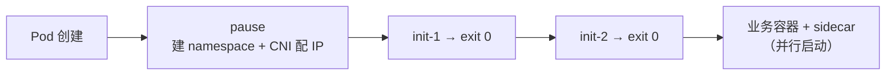

# 2026-10-28 学习日志

## 知识点

- [云原生/容器] Pod 内的三类容器：Infra（pause）/ Init / Sidecar → 详见 [容器技术](/topics/cloud-native/container)
- [知识库] 把「K8s」板块合并进「云原生」，同一知识只保留一处

## 一、Pod 与容器设计模式

来源：CNCF × 阿里云《云原生技术公开课》「Pod 与容器设计模式」。

**为什么要 Pod**：容器是单进程模型（PID 1 的生死 = 容器的生死），当不了 `systemd`，没法在一个容器里管多个有依赖的进程。K8s 把「进程组」抽成一层：**Pod = 进程组，容器 = 进程**。

**pause 容器**：每个 Pod 第一个启动、永不退出的汇编小容器（约 100~200 KB），**持有 Network / IPC / UTS namespace**，业务容器用 `setns()` 平等加入。

- 价值一：打破启动顺序依赖——不用让 A 当 B 的父容器
- 价值二：业务容器反复重启，**Pod IP 和网络栈不变**（namespace 所有者是 pause）
- kubelet 先建 pause（PodSandbox）→ CNI 在它的 netns 里配 IP → 再起 init / 业务容器
- `crictl ps -a` 里的 `k8s_POD_xxx` 就是它；删掉它整个 Pod 重建

**共享边界**：Network / IPC / UTS 默认共享；**PID 默认不共享**（需 `shareProcessNamespace: true`）；Mount 不共享，只能靠 Volume。Volume 是 Pod 级的，kubelet 在宿主机准备目录后 **bind mount** 进各容器——这就是 init 传产物、sidecar 读日志的物理基础。

**Init Container**：按序**串行**、每个必须 `exit 0`，全成功才起业务容器（业务容器之间是并行、无顺序保证）。四类用途：等依赖就绪、预置产物到共享 Volume（WAR + Tomcat 解耦）、数据/权限初始化、高权限操作隔离。

- 不支持三种 probe（本来就是跑完即退）
- Pod 有效资源 = `max(单个 init 最大值, 业务容器之和)`，不是相加
- **1.28+ Native Sidecar**：`initContainers` 里写 `restartPolicy: Always` → 常驻、先于主容器就绪、后于主容器退出，顺手解决 Job 永不完成的老问题

**Sidecar 四种模式**：Sidecar（增强，日志采集）/ Ambassador（出站代理，主容器只连 localhost）/ Adapter（统一格式，exporter）/ Service Mesh 数据面（Istio：webhook 自动注入 + init 容器改 iptables 劫持流量）。代价是资源放大 + 1.28 前的启停顺序问题。

## 二、知识库重构：消除「云原生 / K8s」重合

**问题**：同一知识散落两处——`topics/cloud-native/k8s-core.md` 和 `topics/k8s/*` 各写一遍架构 / API / Service 端口；容器知识一半在 `container.md`、一半在 `k8s/pod/`；还有 5 个「🚧 待补充」空页占着导航。查「容器」得翻好几个地方。

**做法**：

| 动作 | 结果 |
|------|------|
| `topics/k8s/` 整体移入 `topics/cloud-native/k8s/` | 云原生成为唯一顶层入口，K8s 是它的子域 |
| `k8s-core.md` 拆解归并 | 三大能力 / 部署形态 → `k8s/architecture/`；GVK + status / label 速记 → `k8s/api/`；minikube 实操 → `k8s/deployment/`；Service 端口（已在 `k8s/network/` 有更全版本）→ 丢弃 |
| `container.md` 里的「云原生架构标准 / 生态辨析」移到 `overview.md` | 容器页只讲容器 |
| 删掉 `k8s-advanced` / `service-mesh` / `observability` / `gitops` / `tools` 五个空占位页 | 计划内容改成 index 里一行文字，学完再建页 |
| 两个 sidebar 合成一个（云原生 + Kubernetes 两组） | 一次展开看到全部 |

**沉淀的约定**（写进 `topics/cloud-native/index.md`）：容器层面的进 `container.md`，编排层面的进 `k8s/*`，项目落地的进 `projects/*`；同一知识点若两处都需要，**只写一处 + 另一处放链接**，不复制正文。

## 今日总结

pause 容器是整个 Pod 抽象的地基——「谁持有 namespace」这个看似实现细节的选择，才让「容器平等共享、互不依赖启动顺序、重启不丢 IP」三件事同时成立。知识库这边则确认了一条写作纪律：重复的正文比缺失的正文更难维护，宁可留链接。
