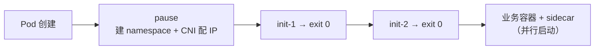

# 2026-10-28 学习日志

## 知识点

- [云原生/K8s] **为什么需要 Pod**：操作系统类比、成组调度问题、亲密关系判断 → 详见 [K8s · Pod](/topics/cloud-native/k8s/pod/)
- [云原生/容器] Pod 内的三类容器：Infra（pause）/ Init / Sidecar → 详见 [容器技术](/topics/cloud-native/container)
- [知识库] 把「K8s」板块合并进「云原生」，同一知识只保留一处

## 一、为什么需要 Pod

来源：CNCF × 阿里云《云原生技术公开课》「理解 Pod 与容器设计模式」（张磊）。

**类比先立住**：容器镜像 = 安装包，容器 = **进程**，Pod = **进程组**，Kubernetes = **操作系统**。操作系统调度的基本单位从来不是孤立进程，而是有协作关系的一组进程。

**理由一：真实应用本来就是进程组**。`rsyslogd` 由主进程 + `imklog` + `imuxsock` 三个进程组成，靠本地 socket 和文件通信，必须同机。用容器跑它，两条路都堵：

- 三个进程塞一个容器 → PID 1 得是 `systemd`/`supervisord`，于是「容器生命周期 = 应用生命周期」被打破，主业务挂了容器还 Running，健康检查与自愈全部失效
- 拆三个独立容器 → 没机制保证同机，本地通信直接断

**理由二：成组调度（Gang Scheduling）**。这个更硬——没有 Pod，调度器会从根上出错。App 要 1 GB、LogCollector 要 0.5 GB 且必须同机，Node-A 剩 1.25 GB、Node-B 剩 3 GB：逐个调度会先把 App 放进 Node-A（够放），轮到 LogCollector 时 Node-A 只剩 0.25 GB → 死局。各家解法：

| 方案 | 做法 | 代价 |
|------|------|------|
| Mesos | 资源囤积，凑齐一组才调度 | 囤积期资源闲置，多组互囤会**死锁** |
| Google Omega | 乐观调度，冲突后回滚 | 实现复杂度极高 |
| **Kubernetes** | **Pod 作为原子调度单位**，调度器眼里没有「单个容器」 | 需要多抽象出 Pod 这一层 |

K8s 的思路是**把问题消灭在定义阶段**，而不是在调度阶段打补丁。

**判断依据**：拆到不同机器会**功能不正确**（而不只是变慢）→ 同一个 Pod；只是想就近 → 不同 Pod + `podAffinity`；只靠网络调用 → 不同 Pod + Service。

## 二、Pod 与容器设计模式

来源：CNCF × 阿里云《云原生技术公开课》「Pod 与容器设计模式」。

**pause 容器**：每个 Pod 第一个启动、永不退出的汇编小容器（约 100~200 KB），**持有 Network / IPC / UTS namespace**，业务容器用 `setns()` 平等加入。

- 价值一：打破启动顺序依赖——不用让 A 当 B 的父容器
- 价值二：业务容器反复重启，**Pod IP 和网络栈不变**（namespace 所有者是 pause）
- kubelet 先建 pause（PodSandbox）→ CNI 在它的 netns 里配 IP → 再起 init / 业务容器
- `crictl ps -a` 里的 `k8s_POD_xxx` 就是它；删掉它整个 Pod 重建

**共享边界**：Network / IPC / UTS 默认共享；**PID 默认不共享**（需 `shareProcessNamespace: true`）；Mount 不共享，只能靠 Volume。Volume 是 Pod 级的，kubelet 在宿主机准备目录后 **bind mount** 进各容器——这就是 init 传产物、sidecar 读日志的物理基础。

**Init Container**：按序**串行**、每个必须 `exit 0`，全成功才起业务容器（业务容器之间是并行、无顺序保证）。四类用途：等依赖就绪、预置产物到共享 Volume、数据/权限初始化、高权限操作隔离。

它的存在理由由「WAR 包 + Tomcat 怎么部署」三次演进推出来：

| 方案 | 问题 |
|------|------|
| ① WAR 和 Tomcat 打成一个镜像 | 改任一个都要重做镜像，版本锁死，无法独立发布与复用 |
| ② 只打 Tomcat，WAR 从宿主机挂载 | 要分布式存储 + 单独维护宿主机上的 WAR，运维负担挪到集群外 |
| ③ **init 容器把 WAR `cp` 到 emptyDir** | 两个镜像各自独立发布复用，无外部存储依赖 ✓ |

- 不支持三种 probe（本来就是跑完即退）
- Pod 有效资源 = `max(单个 init 最大值, 业务容器之和)`，不是相加
- **1.28+ Native Sidecar**：`initContainers` 里写 `restartPolicy: Always` → 常驻、先于主容器就绪、后于主容器退出，顺手解决 Job 永不完成的老问题

**Sidecar 四种模式**：Sidecar（增强，日志采集）/ Ambassador（出站代理，主容器只连 localhost）/ Adapter（统一格式，exporter）/ Service Mesh 数据面（Istio：webhook 自动注入 + init 容器改 iptables 劫持流量）。代价是资源放大 + 1.28 前的启停顺序问题。

**五类常见落地**：日志收集、**Debug 应用**（临时塞带 `curl`/`tcpdump`/`jmap` 的容器进 Pod，业务镜像保持精简）、应用监控（localhost 抓指标转 Prometheus 格式）、**代理容器 Proxy**（应用只连 localhost，代理管服务发现/重试/负载均衡）、适配器容器 Adapter（老格式适配成外部规范）。

> 本质：**业务镜像不必为「可能用到」的能力买单**。所有容器设计模式归结为两个词——**解耦**与**重用**。这是 Google Borg 大规模集群管理的最佳实践，也是 K8s 做复杂编排的基础依赖。

## 三、知识库重构：消除「云原生 / K8s」重合

**问题**：同一知识散落两处——`topics/cloud-native/k8s-core.md` 和 `topics/k8s/*` 各写一遍架构 / API / Service 端口；容器知识一半在 `container.md`、一半在 `k8s/pod/`；还有 5 个「🚧 待补充」空页占着导航。查「容器」得翻好几个地方。

**做法**：

| 动作 | 结果 |
|------|------|
| `topics/k8s/` 整体移入 `topics/cloud-native/k8s/` | 云原生成为唯一顶层入口，K8s 是它的子域 |
| `k8s-core.md` 拆解归并 | 三大能力 / 部署形态 → `k8s/architecture/`；GVK + status / label 速记 → `k8s/api/`；minikube 实操 → `k8s/deployment/`；Service 端口（已在 `k8s/network/` 有更全版本）→ 丢弃 |
| `container.md` 里的「云原生架构标准 / 生态辨析」移到 `overview.md` | 容器页只讲容器 |
| 删掉 `k8s-advanced` / `service-mesh` / `observability` / `gitops` / `tools` 五个空占位页 | 计划内容改成 index 里一行文字，学完再建页 |
| 两个 sidebar 合成一个（云原生 + Kubernetes 两组） | 一次展开看到全部 |

**沉淀的约定**（写进 `topics/cloud-native/index.md`）：容器层面的进 `container.md`，编排层面的进 `k8s/*`，项目落地的进 `projects/*`；同一知识点若两处都需要，**只写一处 + 另一处放链接**，不复制正文。

## 今日总结

Pod 这层抽象有两个独立的理由，缺一个都站不住：**进程模型**上它让容器守住「一个容器一个进程」（生命周期才能被精确管理、健康检查才有意义），**调度模型**上它作为原子单位把成组调度问题消灭在定义阶段——Mesos 用资源囤积、Omega 用乐观回滚去「解决」这个问题，K8s 选择让问题不存在。pause 容器则是这层抽象的地基：「谁持有 namespace」这个看似实现细节的选择，让容器平等共享、互不依赖启动顺序、重启不丢 IP 三件事同时成立。

知识库这边确认了一条写作纪律：重复的正文比缺失的正文更难维护，宁可留链接。
