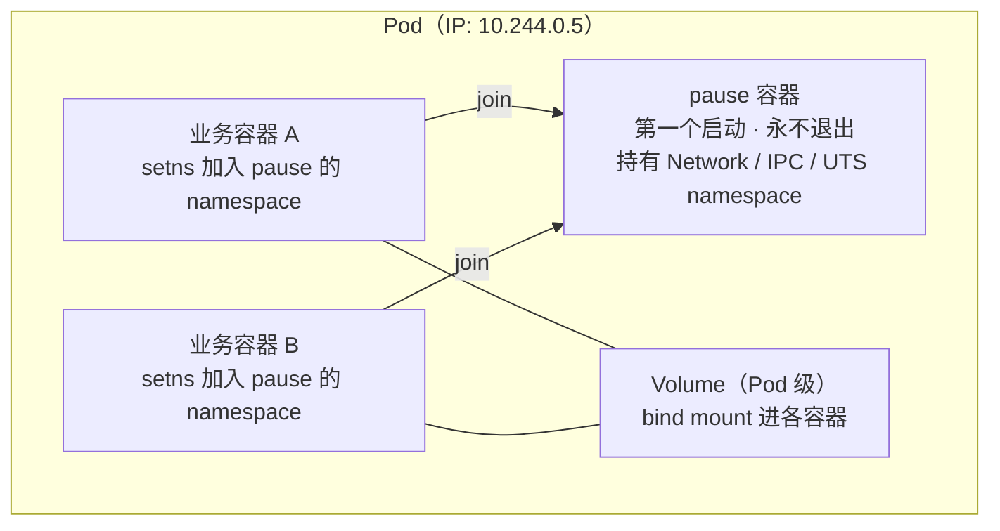
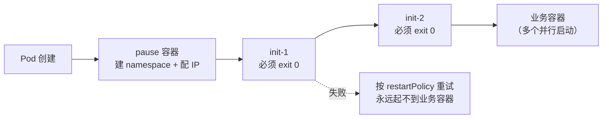
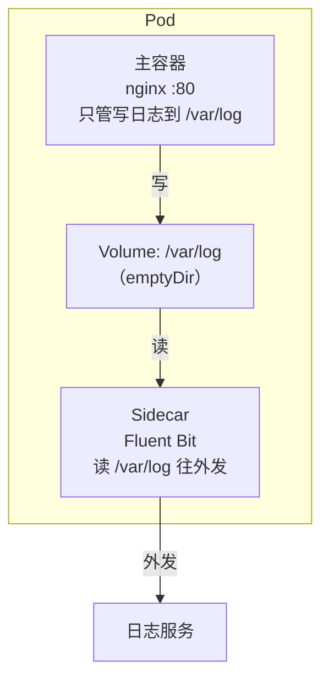

# 容器技术

## 核心概念 <2026-05-18>

### 容器

**定义**: 和系统其他部分隔离开的**进程集合**

- 容器不是虚拟机，本质就是进程
- 这些进程被 Namespace + Cgroups "圈"起来——看不到外面、也不能用超额资源
- "进程集合"——一个容器里可以有多个进程（但推荐只有一个主进程）

### 镜像

**定义**: 容器所需要的**所有文件集合** — Build once, Run anywhere

- 镜像 = 文件系统快照（代码 + 依赖 + 配置 + 运行时）
- Build once — 构建一次打成镜像
- Run anywhere — 在任何有容器引擎的地方都能跑

### 两者关系

| | 类比 | 说明 |
|---|---|---|
| 镜像 | "菜谱" | 静态的文件集合 |
| 容器 | "做出来的菜" | 运行中的隔离进程 |

镜像提供文件 → 容器引擎用这些文件启动隔离的进程 → 就是一个运行中的容器。

---

## 容器生命周期 <2026-05-18>

### 单进程模型

```
容器启动 → Init 进程（PID 1）启动
      ↓
Init 进程运行中 → 容器运行中
      ↓
Init 进程退出 → 容器停止 ☠️
```

**关键点:**
- PID 1 进程（Init 进程）就是容器的"灵魂"
- "单进程模型"不是说只能有一个进程，而是只有 PID 1 的生死决定容器的生死
- `docker exec` 启动的是额外进程，退出不影响容器（用于调试运维）

### 数据持久化

容器可写层是临时的（ephemeral），容器删除数据就丢。要持久化数据，必须用数据卷——生命周期独立于容器。

**两种数据卷方式:**

| 方式 | 命令示例 | 数据存放位置 |
|------|---------|-------------|
| Bind Mount | `docker run -v /host/path:/container/path ...` | 宿主机你指定的目录 |
| Docker Volume（推荐） | `docker volume create mydata` + `docker run -v mydata:/data ...` | Docker 托管 `/var/lib/docker/volumes/` |

**查看日志两种方式:**

| 方式 | 命令 | 场景 |
|------|------|------|
| `docker logs` | `docker logs -f demo` | 查看 stdout/stderr（推荐） |
| exec + cat | `docker exec demo cat /var/log/app.log` | 查看容器内日志文件 |

**最佳实践:** 云原生推荐日志输出到 stdout/stderr，不写文件：
- ✅ `docker logs` 直接看
- ✅ K8s Fluentd 自动采集
- ✅ 不撑爆容器内磁盘

---

## 镜像分层机制 <2026-05-18>

**场景**: 理解 Docker 镜像是如何组织文件的

**要点:**
- 每一层就像对磁盘做了一次快照，只记录相对于上一层的变化（增/删/改了哪些文件）
- 类似 Git commit：每个 commit 只记录 diff，多个分支共享相同的历史 commit
- 好处：复用层（100 个容器用同一个 alpine 只存一份）、增量下载、节省磁盘

---

## Dockerfile 核心指令 <2026-05-18>

### COPY vs ADD

| 指令 | 功能 | 建议 |
|------|------|------|
| COPY | 单纯复制文件 | ✅ 优先使用 |
| ADD | 复制 + 自动解压 tar + 支持 URL | ⚠️ 只在需要解压时用 |

Docker 官方建议：能用 COPY 就不用 ADD，因为 COPY 行为更明确可预测。

### 分层 COPY 优化构建（利用层缓存）

```dockerfile
FROM node:18-alpine
WORKDIR /app
COPY package*.json ./     # ← 先复制依赖声明
RUN npm install           # ← 安装依赖
COPY . .                  # ← 再复制源码
```

改源码时只重建最后一层，`npm install` 命中缓存 → 大幅加速构建。

### docker build -t

给镜像"取名字"，方便后续引用和管理：

```bash
docker build . -t app:v1              # 镜像名 app，标签 v1
docker build . -t app:v1 -t app:latest  # 同时打多个标签
```

### docker run 参数

```bash
docker run [-d] --name demo busybox:1.25 top
#         │      │           │           │
#         │      │           │           └─ 执行的命令
#         │      │           └─────────── 镜像:tag
#         │      └──────────────────────── 容器名
#         └──────────────────────────────── 后台运行（detach）
```

---

## 容器 vs VM <2026-05-18>

| 对比项 | 容器 | 虚拟机 |
|--------|------|--------|
| 本质 | 进程隔离 | 硬件模拟 |
| 隔离方式 | Namespace + Cgroups | Hypervisor |
| 启动速度 | 秒级 | 分钟级 |
| 体积 | MB 级 | GB 级 |
| 性能 | 接近原生 | 有损耗 |
| 安全性 | 共享内核（相对弱） | 独立内核（更强） |

---

## 容器进阶 <2026-05-19>

### PID Namespace 深入

**共享 PID Namespace:**
- `--pid container:demo` → 两个容器共享 PID namespace，能看到并操作对方进程
- 共享方 `kill 1` 可以杀死目标容器的 PID 1 → 目标容器停止
- PID namespace owner 退出 → namespace 销毁 → 依赖它的容器也退出

**PID 1 信号保护机制（重要！）:**
- ⚠️ 容器**内部**发给 PID 1 的信号会被内核丢弃（即使 SIGKILL）
- 宿主机上发 `kill -9 <真实PID>` 则能杀死
- `docker exec` 进入容器后 `kill -9 1` → 无效！
- 宿主机 `kill -9` 后容器退出码 137（= 128 + 9）

### 容器自动重启

```bash
docker run -d --restart always busybox top
```

- 需要 `-d`（后台） + `--restart always` 同时存在
- restart 策略：`no`（默认）、`on-failure[:max]`、`always`、`unless-stopped`

### Live Restore

- dockerd 重启/升级时，已运行容器**不会停止**
- 检查方式：`docker info | grep 'Live Restore Enabled'` 或 <span v-pre>`docker info -f '{{.LiveRestoreEnabled}}'`</span>
- 配置：`/etc/docker/daemon.json` 中 `"live-restore": true`

### 容器引擎架构（解耦设计）

```
用户 → Docker CLI → dockerd (moby daemon)
                         ↓
                    containerd（容器生命周期管理）
                         ↓
                    containerd-shim（每个容器一个）
                         ↓
                      runc（OCI 标准，创建容器）
```

**moby daemon (dockerd):**
- 2017 年 Docker 核心开源组件拆出重命名为 Moby
- 管构建、网络、存储；"跑容器"委托给 containerd
- K8s 场景下已跳过 dockerd，kubelet 直连 containerd（CRI）

**containerd:**
- CNCF 毕业项目，容器生命周期管理
- 负责：镜像拉取/推送、容器创建/启动/停止、快照管理

**containerd-shim:**
- 每个容器一个 shim 进程
- 作用：解耦 containerd，containerd 重启不影响运行中容器
- 收集容器退出状态，管 stdin/stdout

**runc:**
- OCI 标准实现，只负责「创建」容器
- 创建完就退出，不是常驻进程

---

## Pod 内的三类容器：Infra / Init / Sidecar <2026-10-28>

> 来源：CNCF × 阿里云《云原生技术公开课》「Pod 与容器设计模式」。
> 这一节把前面的单容器知识接到编排层——「一个 Pod 里为什么会有多个容器、它们凭什么能共享」。Pod 自身的调度与生命周期见 [K8s · Pod](/topics/cloud-native/k8s/pod/)。

### 为什么要有 Pod：容器是单进程模型

容器的本质是「只有一个 PID 1 的进程」（见本页「容器生命周期」一节），所以它当不了虚拟机里的 `systemd`——没法在一个容器里优雅地管理多个有依赖关系的进程（谁拉起谁、父进程挂了怎么办、僵尸进程谁回收）。

但真实应用里确实存在**必须部署在一起**的「进程组」：WAR 包 + Tomcat、应用 + 日志采集、应用 + 本地代理。K8s 的解法是把进程组这一层抽出来：

> **Pod = 进程组，容器 = 进程**。调度、资源、网络身份、生命周期全都按 Pod 这个整体算，容器只是里面的一个进程。

### Infra Container（pause 容器）：共享关系的锚点

同一个 Pod 里的容器 A、B 谁先启动是不确定的。如果让 A 持有 namespace、B 去加入，就凭空造出了「B 依赖 A 先起来」的顺序约束。K8s 用一个额外的、永远第一个启动的 **Infra 容器（pause）** 打破这种不对称——A、B 都只是「平等地加入 pause」：



| 维度 | 说明 |
|------|------|
| 镜像 | `registry.k8s.io/pause`，汇编写的，解压后约 100~200 KB |
| 进程 | 启动后立刻卡在 `pause()` 系统调用上挂起，只负责接管信号，几乎不耗 CPU |
| 核心作用 | **持有 Pod 的 Network / IPC / UTS namespace**，其余容器用 `setns()` 加入（运行时层面即 `--net=container:<pause-id>`） |
| 关键收益 | 业务容器可以反复重启、换镜像，**Pod IP 和整个网络栈不变**——namespace 的所有者是 pause，不是业务容器 |
| 启动顺序 | kubelet 先建 pause（即 PodSandbox），拿到 netns 后交给 CNI 配 IP，再起 init / 业务容器 |
| 僵尸回收 | 开了共享 PID namespace 时，pause 作为 PID 1 负责 `wait()` 收割孤儿进程 |

> 排障：`crictl ps -a` / `docker ps` 里看到的 `k8s_POD_xxx` 就是它。**它被删 → 整个 Pod 重建**（IP 也会变）。

**Pod 内 namespace 共享矩阵**：

| Namespace | 默认共享 | 效果 |
|-----------|---------|------|
| **Network** | ✅ | 同一个 Pod IP、同一套 eth0/lo、同一端口空间（容器间端口不能撞），互相可用 `localhost` 访问 |
| **IPC** | ✅ | 可用 System V IPC / POSIX 共享内存、消息队列通信 |
| **UTS** | ✅ | 共享 hostname（即 Pod 名） |
| **PID** | ❌ | 需 `spec.shareProcessNamespace: true`，开了才能互看进程，此时 pause 是 PID 1 |
| **Mount** | ❌ | 各容器有独立根文件系统，只能通过 Volume 显式共享目录 |

**Volume 的共享实现**：Volume 声明在 `spec.volumes`（Pod 级，生命周期属 Pod），kubelet 在宿主机准备目录 `/var/lib/kubelet/pods/<pod-uid>/volumes/...`，再 **bind mount** 进各容器声明的 `mountPath`。所以多个容器挂同一个 volume 就是在读写同一份宿主机目录——这正是 init 容器传递产物、sidecar 读日志的物理基础。Volume 类型详见 [PV/PVC](/topics/cloud-native/k8s/pv-pvc/)。

### Init Container：顺序执行、跑完就退

`initContainers` 列表里的容器**按书写顺序串行执行**，每个都必须 `exit 0`，全部成功后才启动 `containers`；而业务容器之间是并行启动、**没有顺序保证**。所以「保证某件事发生在应用启动之前」只能靠 init 容器。



**四类典型用途**：

| 用途 | 例子 |
|------|------|
| 等依赖就绪 | `until nc -z db 3306; do sleep 2; done` |
| 预置产物到共享 Volume | 把 WAR 包 / 配置 / 证书 / 代码 `cp` 到 emptyDir，Tomcat 容器再从同一目录读 |
| 数据初始化 | DB schema 迁移、挂载目录 `chown` / `chmod` |
| 高权限操作隔离 | 改 `sysctl`、内核参数的活给 init 容器干，主容器不必带着高权限长跑 |

**行为细节（容易踩）**：

- **不支持** `livenessProbe` / `readinessProbe` / `startupProbe`——它本来就是「跑完即退」
- Pod 的有效资源 = `max(所有 init 容器的最大值, 所有业务容器之和)`，不是简单相加
- 失败按 Pod 的 `restartPolicy` 重试，`Always` 时等价于 `OnFailure`

```yaml
spec:
  initContainers:
    - name: prepare-war            # 经典例子：WAR 包与 Tomcat 解耦成两个镜像
      image: myapp-war:1.0
      command: ['cp', '/app.war', '/app/']
      volumeMounts:
        - { name: app, mountPath: /app }
  containers:
    - name: tomcat
      image: tomcat:9
      volumeMounts:
        - { name: app, mountPath: /usr/local/tomcat/webapps }
  volumes:
    - name: app
      emptyDir: {}
```

> K8s **1.28+** 引入 **Native Sidecar**：在 `initContainers` 里写 `restartPolicy: Always`，这个「init 容器」会常驻运行、**先于业务容器就绪、后于业务容器退出**（1.29 起默认启用）。

### Sidecar：容器设计模式

**思想**：把与主业务「非核心但强相关」的能力拆成同一个 Pod 内的辅助容器，靠共享 Network / Volume 协作——关注点分离、各自独立发版、语言无关、主应用代码零侵入。



| 模式 | 做什么 | 实例 |
|------|--------|------|
| **Sidecar** | 增强主容器能力 | 日志采集（Fluent Bit / Filebeat 读 emptyDir）、配置热更新（config-reloader） |
| **Ambassador**（大使） | 代理出站流量，主容器只连 `localhost` | Envoy、数据库连接代理、分库分表代理 |
| **Adapter**（适配器） | 统一对外暴露格式 | 各类 exporter 把应用指标转成 Prometheus 格式 |
| **Service Mesh 数据面** | 透明接管进出流量 | Istio `istio-proxy`：MutatingAdmissionWebhook 自动注入 + init 容器改 iptables 劫持流量 |

**代价与注意点**：

- 资源放大——每个 Pod 都多一份代理开销（Istio 这类 Mesh 的主要成本来源）
- **启停顺序**：1.28 之前普通 sidecar 无法保证「先于主容器就绪、后于主容器退出」，主容器起来时代理可能还没 ready → 用 Native Sidecar 解决
- **Job 场景**：sidecar 不退出会让 Job 永远完不成（同样靠 Native Sidecar 解决）

### 一句话总结

> **Pod = 共享 Network / IPC / UTS namespace + 共享 Volume 的一组容器**。pause 容器充当 namespace 的持有者、打破启动顺序依赖，kubelet + CRI + CNI + CSI 协同完成「隔离中的共享」——init container（顺序初始化）与 sidecar（协同增强）这两种设计模式才得以成立。
