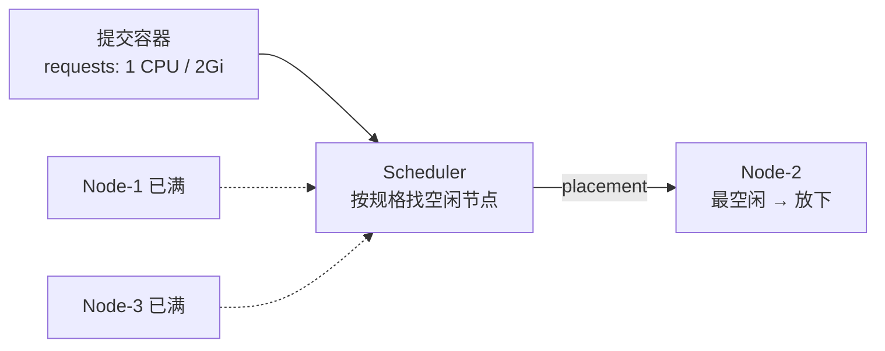
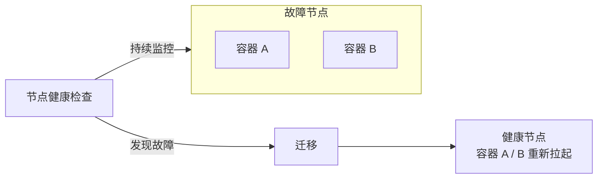
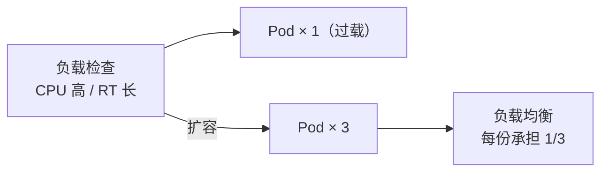
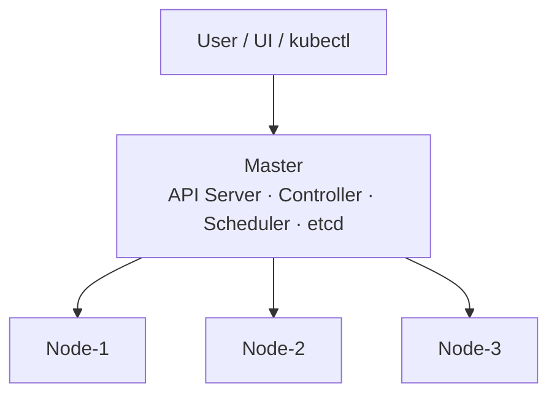
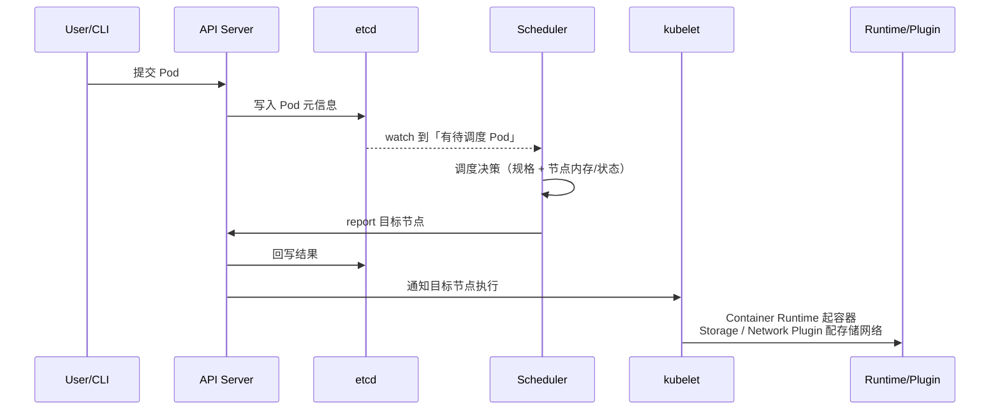

# Kubernetes 核心概念

## K8s 架构 <2026-05-19>

### 定位

- 自动化容器编排平台（部署 + 弹性 + 管理）
- 8 大核心功能：服务发现、自动装箱、存储编排、自动恢复、自动发布与回滚、配置管理、批量执行、水平伸缩
- 不是 PaaS，提供编排"原语"；可基于 K8s 构建 PaaS（KubeSphere、Rancher）

### Master 组件（控制面）

| 组件 | 职责 |
|------|------|
| API Server | 集群前门，所有请求经过它，唯一操作 etcd 的组件 |
| Controller Manager | 维护期望状态（实际 = 期望），包含多种 controller |
| Scheduler | 决定 Pod 放到哪个 Node（资源、亲和、策略） |
| etcd | 分布式 KV 存储，保存集群所有状态 |

### Node 组件（数据面）

| 组件 | 职责 |
|------|------|
| Pod | 最小调度单元 |
| Kubelet | Node 管家，管理 Pod 生命周期，向 API Server 汇报状态 |
| Container Runtime | 跑容器（containerd），通过 CRI 接口 |
| Kube-proxy | 网络代理，实现 Service 负载均衡（iptables/IPVS） |
| Storage Plugin (CSI) | 存储插件 |
| Network Plugin (CNI) | 网络插件 |

### 调用流程

```
kubectl apply → API Server → 存 etcd
     → Controller 发现差异 → 创建 Pod 对象
     → Scheduler 选 Node → 写入 nodeName
     → Kubelet Watch 到 → 拉镜像 → 启动容器
```

### 核心模式：Watch + 声明式

- 所有组件 Watch API Server，发现变化就行动
- 用户只描述"期望状态"（spec），系统自动趋近
- 对比命令式："执行 A → B → C"；声明式："我要 3 个副本"

---

## 核心资源对象 <2026-05-19>

### Pod

- K8s 最小调度单元，一个或多个容器
- 同 Pod 容器共享：网络（同 IP）、Volume、可共享 PID namespace
- 定义运行方式：Command、环境变量、资源 requests/limits

### Volume

- 声明在 Pod 中的文件目录
- 可被多容器共享，生命周期与 Pod 绑定
- 支持多种后端：emptyDir、hostPath、PV/PVC、ConfigMap、Secret

### Deployment

- 管理一组 Pod 的副本数、版本
- 自动恢复失败 Pod
- 滚动升级：逐步替换旧版 Pod
- 回滚：一键回到之前版本

### Service

- 提供稳定的访问入口（固定 ClusterIP），负载均衡到后面的 Pod
- 三种类型：
  - **ClusterIP**（默认）：集群内访问
  - **NodePort**：节点端口暴露
  - **LoadBalancer**：云 LB 暴露
- 通过 **label selector** 找到对应的 Pod

### Namespace

- 集群内逻辑隔离（鉴权、资源配额）
- 同 Namespace 资源名唯一，跨 Namespace 可重名
- 默认 namespace：default、kube-system、kube-public

### Label

- Key:Value 键值对，打在资源上
- 通过 selector 查询匹配 —— K8s **核心关联机制**
- Service / Deployment / HPA 都通过 label 找 Pod（松耦合）

---

## K8s API 结构 <2026-05-19>

```yaml
apiVersion: v1        # API 版本（v1, apps/v1, batch/v1...）
kind: Pod             # 资源类型
metadata:             # 元数据（name, labels, namespace, annotations）
  name: my-pod
  labels:
    app: web
spec:                 # 期望状态（具体内容因 kind 而异）
  containers:
    - name: web
      image: nginx:1.25
```

**GVK 模型**: Group + Version + Kind → 唯一确定一种资源类型

> 💡 读取资源时会多出一个 `status` 字段（当前状态：Pending / Running / Terminated），由系统回写，用户只写 `spec`。

---

## Service 端口对应关系 <2026-05-19>

```
外部请求 → Service:port → Pod:targetPort → Container:containerPort
```

| 层 | 字段 | 含义 |
|----|------|------|
| Service | `port` | Service 对外暴露的端口 |
| Service | `targetPort` | 转发到 Pod 的端口 |
| Pod | `containerPort` | 容器内应用监听的端口 |

**示例:**
```yaml
apiVersion: v1
kind: Service
metadata:
  name: web-svc
spec:
  selector:
    app: web
  ports:
    - port: 80          # 访问 web-svc:80
      targetPort: 8080  # 转发到 Pod 的 8080
---
apiVersion: v1
kind: Pod
metadata:
  labels:
    app: web
spec:
  containers:
    - name: app
      image: my-app
      ports:
        - containerPort: 8080  # 应用监听 8080
```

> 💡 `targetPort` 和 `containerPort` 通常一致；`port` 可以不同（对外统一暴露 80/443）。

---

## 本讲三大核心能力 <2026-10-19>

> 来源：CNCF × 阿里云《云原生技术公开课》第 3 讲「Kubernetes 核心概念」（李响）文字版。

K8s = **工业级的容器编排平台**，负责应用的部署、弹性与管理，全部基于容器。单词来自希腊语「舵手 / 飞行员」；`k8s` 是把 `ubernete` 这 8 个字母换成 `8`。取「舵手」是双关——container 的另一含义是「集装箱」，K8s 要当那艘运集装箱的船。

**调度（Scheduling）**



**自动修复（Self-healing）**：节点健康检查持续监控宿主机，发现宿主机 / OS 故障后，把该节点上的容器迁到健康节点。



**水平伸缩**：业务负载检查发现 CPU 利用率过高 / 响应时间过长 → 扩容，再用负载均衡把流量摊到多份。



---

## 架构补充：组件的部署形态 <2026-10-19>

Master 四组件（API Server / Controller / Scheduler / etcd）的部署形态不同：

| 组件 | 部署形态 | 高可用方式 |
|------|----------|-----------|
| API Server | 无状态，**可水平扩展** | 多副本 + 前面挂 LB |
| Controller | **只有一个 active** | 多副本热备，抢 leader |
| Scheduler | **只有一个 active** | 多副本热备，抢 leader |
| etcd | 分布式 KV | Raft 多数派，撑起整个 Master 的高可用 |

二层 + server-client 架构：**User（UI / CLI）只连 Master**，Node 不与用户直连，所有指令由 Master 下发。



Node 侧边界：K8s **自己不做网络和存储**，靠 **Storage Plugin** / **Network Plugin**（CSI / CNI）落地；Service 那层组网由 **kube-proxy** 借 iptables 完成。

---

## 一次 Pod 调度执行的完整链路 <2026-10-19>



和 [K8s 架构](/topics/k8s/architecture/) 里的「Pod 创建全链路」是同一套 Watch 总线，只是分步拆得更细。

---

## Label / Selector 速记 <2026-10-19>

- label 是 **KeyValuePair**（`color=red`、`size=big`），写在 `metadata` 里
- selector 语义 ≈ SQL 的 `where`：3 个 Pod 里 `color=red` 只命中 2 个，黄色那个落选
- Deployment「一组 Pod」、Service「一组 Pod」，这些「一组」全都用 label selector 表达——这是 K8s 描述资源集合的默认方式

---

## 动手 Demo：minikube + nginx <2026-10-19>

环境三件套：VirtualBox → minikube（用阿里云版，Google 依赖换成了国内镜像）→ `minikube start --vm-driver virtualbox`

```bash
kubectl apply -f https://k8s.io/examples/application/deployment.yaml          # 建 2 副本 nginx:1.7.9
kubectl apply -f https://k8s.io/examples/application/deployment-update.yaml    # 升级 image → 1.8
kubectl apply -f https://k8s.io/examples/application/deployment-scale.yaml     # replicas 2 → 4
kubectl delete deployment nginx-deployment                                     # 清理回干净状态
```

观察手段：

| 命令 | 看什么 |
|------|--------|
| `kubectl get deployment -w` | replicas / up-to-date 数字滚动变化 |
| `kubectl describe deployment nginx-deployment` | selector、image 版本、deployment-controller 的动作 |

要点：**同一个对象换份 YAML 再 apply 就完成升级 / 扩容**，不用手工删旧建新——控制器按 spec 收敛。
