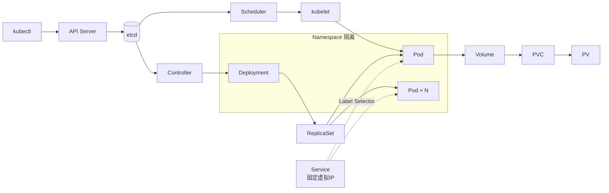

# ☸️ Kubernetes 知识

> Kubernetes 是[云原生](/topics/cloud-native/)体系里的编排层。容器本身（镜像、Namespace、pause / init / sidecar 容器）统一放在 [容器技术](/topics/cloud-native/container) 一页。

## 定位

- 自动化**容器编排平台**：部署 + 弹性 + 管理，全部基于容器
- 八大核心功能：服务发现与负载均衡、自动装箱、存储编排、自动恢复、自动发布与回滚、配置管理、批量执行、水平伸缩
- **不是 PaaS**：只提供编排「原语」（Pod / Service / Deployment…），构建、日志、监控要自己配或装插件；可以基于它造 PaaS（KubeSphere、Rancher），但它自己不是
- 标准扩展机制：CNI、CSI、CRD + Operator、Device Plugin

## 分类

- [架构](/topics/cloud-native/k8s/architecture/) - Master 组件 / 部署形态与高可用 / Pod 创建全链路 / 三大核心能力
- [安装部署](/topics/cloud-native/k8s/install/) - kubeadm 从零部署单节点集群与踩坑
- [API 基础](/topics/cloud-native/k8s/api/) - API 设计 / GVK / Label & Selector / Namespace
- [Node](/topics/cloud-native/k8s/node/) - 节点管理与调度
- [Deployment](/topics/cloud-native/k8s/deployment/) - 部署、滚动更新、回滚、minikube 实操
- [Pod](/topics/cloud-native/k8s/pod/) - Pod 生命周期、调度、与容器的关系
- [PV/PVC](/topics/cloud-native/k8s/pv-pvc/) - 持久化存储
- [Service](/topics/cloud-native/k8s/service/) - 服务发现与负载均衡
- [网络](/topics/cloud-native/k8s/network/) - 三种 IP / Service 端口三件套 / CNI / 虚拟网卡
- [GPU 工作负载](/topics/cloud-native/k8s/gpu/) - GPU device plugin、qGPU 切片、TCE 排障

## 最近更新

## K8s 核心概念速查（2026-06-17 学习）

| 概念 | 一句话 |
|------|--------|
| API Server | 集群唯一入口，所有操作必经 |
| etcd | 集群内存，存所有对象的真实状态 |
| Controller | 持续对比期望 vs 实际，趋近期望 |
| Scheduler | 为 Pod 选节点（过滤 + 打分） |
| kubelet | 节点代理，watch + 启容器 |
| Pod | 最小调度单元，共享网络和存储 |
| Deployment | 管理 Pod 版本和副本数 |
| ReplicaSet | 维持指定数量的 Pod 副本 |
| Service | 稳定虚拟 IP，Pod 随便换外面无感知 |
| Namespace | 逻辑租户隔离 |
| Label/Selector | 松耦合关联机制 |

---

- **2026-06-17** [K8s 11 个核心概念系统性学习](/topics/cloud-native/k8s/architecture/) —— 架构、Pod、Deployment、Service、Volume/PV-PVC、API、Label/Selector、Namespace 全覆盖
- **2026-05-07** [TCE + qGPU 工作负载从 0 到跑通全流程](/topics/cloud-native/k8s/gpu/) —— NVML Unknown Error、qGPU 切片、namespace label、Pod 诊断、后台运行方案
- **2026-05-07** [Pod 未就绪的三板斧诊断](/topics/cloud-native/k8s/pod/)
- **2026-05-07** [污点与容忍度](/topics/cloud-native/k8s/node/)、[查看节点 GPU 资源](/topics/cloud-native/k8s/node/)

