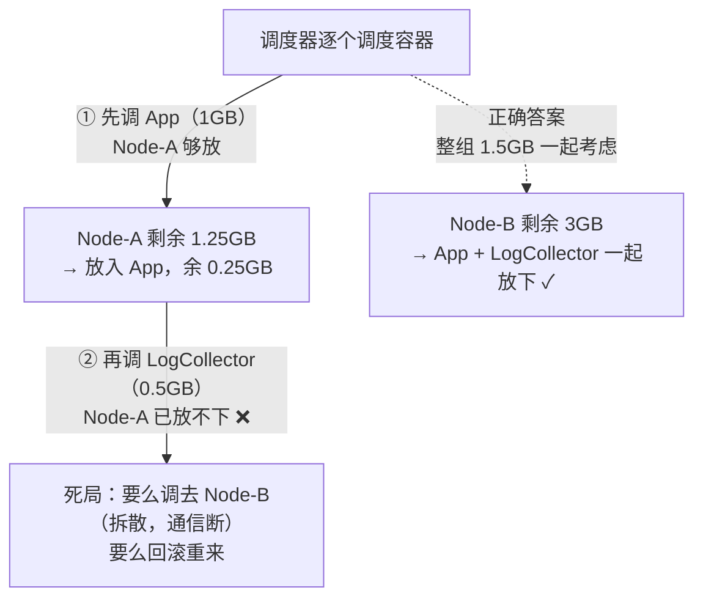
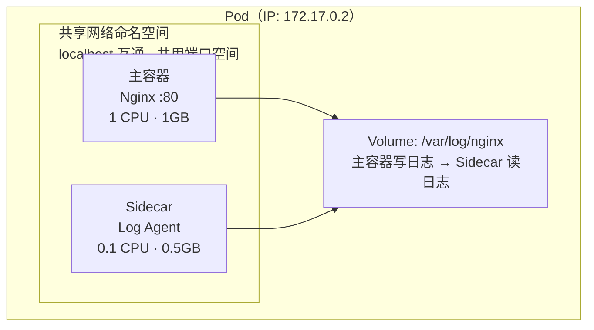
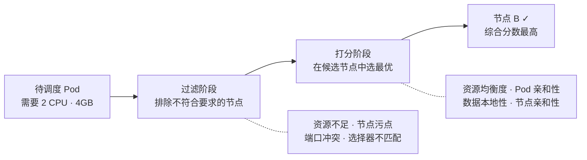

# Pod

记录 Pod 的定位、共享机制与调度原理。

> 📌 **容器层面的知识统一放在一处**：pause（Infra）容器、Init 容器、Sidecar 四种设计模式、namespace / Volume 共享的实现原理，全部见 [容器技术 · Pod 内的三类容器](/topics/cloud-native/container)。本页只讲 Pod 这个对象本身。

## 知识点

## 为什么需要 Pod <2026-10-28>

> 来源：CNCF × 阿里云《云原生技术公开课》「理解 Pod 与容器设计模式」（张磊）。
> Pod 是 K8s 里**最让人困惑的设计**——明明有容器了，为什么还要再套一层？答案有两个层次：进程模型的要求、调度模型的要求。

### 一个类比：Kubernetes 是操作系统

| 云计算概念 | 单机类比 |
|-----------|---------|
| 容器镜像 | 软件安装包（`.exe`） |
| 容器 | **进程** |
| Pod | **进程组** |
| Kubernetes | **操作系统** |

把这个类比拿准，后面全部推论都是顺的：操作系统调度的基本单位从来不是「一个孤立的进程」，而是**有协作关系的一组进程**。

### 层次一：真实应用本来就是进程组

Linux 上 `pstree -g` 看任何一个正经服务，都不是单进程。典型的 `rsyslogd`：

```
rsyslogd（主进程）
 ├─ imklog     读内核日志
 └─ imuxsock   收本机其他进程的日志
```

这三个进程**必须在同一台机器上**——它们靠 socket 和本地文件交换数据，拆开就崩。

那么用容器怎么跑？两条路都不好走：

| 做法 | 问题 |
|------|------|
| **三个进程塞进一个容器** | 容器 PID 1 只能是 `systemd` / `supervisord` 这类管理进程，于是：①「容器的生命周期 = 应用的生命周期」被打破，主业务挂了容器还活着；② 健康检查 / 自愈全部失效（K8s 看到容器 Running，实际业务已死）；③ 镜像里要塞一套进程管理工具，违背单一职责 |
| **拆成三个独立容器** | 没有任何机制保证它们落在同一台机器上，socket 和本地文件通信直接断 |

所以必须有一层东西来表达「这几个容器是一伙的」——这就是 Pod。它是**容器设计模式**的载体，源自 Google Borg 十年的大规模集群管理实践。

### 层次二：成组调度（Gang Scheduling）问题

这是比「进程模型」更硬的理由：**没有 Pod，调度器会从根上出错**。

假设 App 容器要 1 GB、LogCollector 容器要 0.5 GB，两者必须同机共享 Volume。集群里 Node-A 剩 1.25 GB、Node-B 剩 3 GB（示意数字）：



逐个调度必然踩坑：**先放下的那个会把名额占掉**，后面的兄弟无处可去。各家调度器的解法：

| 方案 | 做法 | 代价 |
|------|------|------|
| **Mesos** | 资源囤积（resource hoarding）：等一组任务的资源全部凑齐，才统一调度 | 囤积期间资源闲置；多组互相囤积会**死锁** |
| **Google Omega** | 乐观调度：先调度，事后检测冲突再回滚 | 实现复杂度极高，要处理回滚与重试 |
| **Kubernetes** | **把 Pod 作为原子调度单位**——调度器眼里从来只有 Pod，不存在「单个容器」 | 需要抽象出 Pod 这层概念 |

> K8s 的做法是**把问题消灭在定义阶段**，而不是在调度阶段打补丁：资源需求按 Pod 整体计算，Pod 不可拆分地落到一个节点上，成组调度问题自然不存在。

### 判断依据：亲密关系 vs 非亲密关系

要不要塞进同一个 Pod，就看是哪种关系：

| 关系 | 含义 | 解法 |
|------|------|------|
| **超亲密关系**（必须同机） | 共享 Volume 交换文件、`localhost` / 本地 socket 通信、需要共享 IPC / namespace、频繁 exec 互查 | **同一个 Pod 内的多个容器** |
| 普通亲密关系（最好同机） | 希望就近部署降低延迟，但拆开仍能工作 | 不同 Pod + 亲和性调度（`podAffinity`） |
| 非亲密关系（随便放） | 只靠网络调用，IP 可变 | 不同 Pod + [Service](/topics/cloud-native/k8s/service/) |

**判断口诀**：如果两个容器拆到不同机器上就**功能不正确**（不只是慢），才放进同一个 Pod。否则一律拆开——Pod 内的容器同生同死、一起调度、一起扩缩，耦合代价不小。

### 一句话总结

> Pod 是 K8s 实现「容器设计模式」的核心机制：它既让容器守住**单进程模型**（每个容器只跑一个进程，生命周期可被精确管理），又用**原子调度单位**的身份解决了成组调度问题。所有设计模式的本质都是两个词——**解耦**与**重用**。

---

## 核心概念 <2026-06-17>

**场景**：系统性学习 Pod 作为 K8s 最小调度单元的设计理念。

Pod 是**容器的「机箱」**——把一组紧密协作的容器装在一起，给它们共享的网络和存储。



**三个关键点**：

1. **IP 是 Pod 级别的，不是容器的**：Pod 内所有容器共用同一个 IP，用 `localhost` 通信。一个 Pod 内不能两个容器抢同一个端口。

2. **Volume 是共享的**：主容器写日志到 Volume，Sidecar 直接读——不走网络、不走内存拷贝，文件就是通信媒介。

3. **同生同死、一起调度**：调度器把 Pod 作为整体分配，不会被拆散到不同节点。重启时一起重建，不适合放独立服务。

**常见 Sidecar 模式**：日志采集（Filebeat）、服务注册（Consul Agent）、代理转发（Envoy）——详细的四种模式与代价见 [容器技术 · Sidecar](/topics/cloud-native/container)。

---

## 调度器工作原理 <2026-06-17>

**场景**：理解 Scheduler 如何为 Pod 选择最优节点（不只是「找空闲机器」）。



**调度不是「谁空就放谁」**，而是先排除不合要求的（不足资源、有 Taint），再在候选节点中打分（资源均衡、数据就近、亲和匹配），选出最优。
